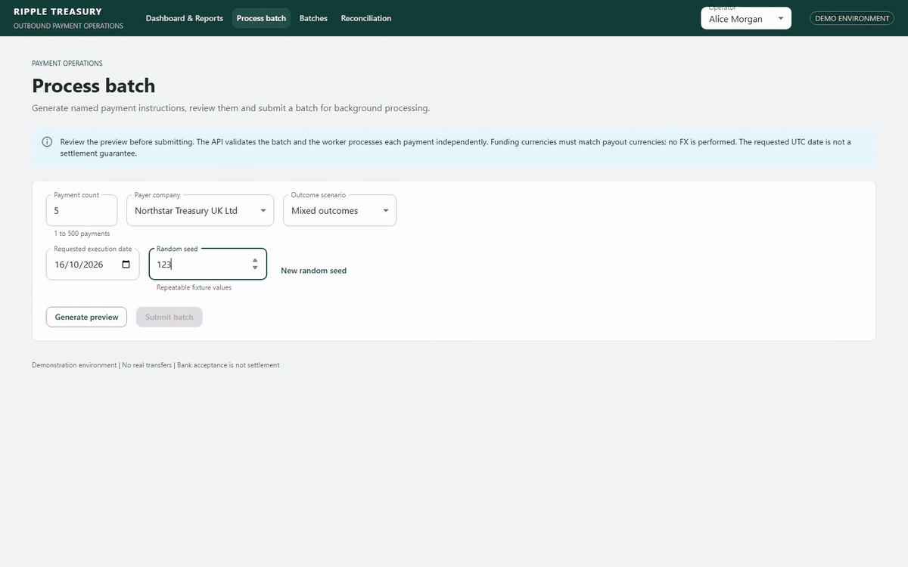

# Ripple Treasury

A .NET 10 / C# 14 / EF Core 10 payment-batch service with a lightweight React/MUI operations UI. It demonstrates exact money handling, atomic intake, idempotency, independent background execution, audit history and conservative recovery from uncertain bank outcomes.

The React UI was added as an extra operations/demo interface for better visibility and
testing of the backend workflow. It lets reviewers generate batches, inspect company and
payment details, follow processing outcomes, review audit history and exercise safe
reconciliation without constructing every API request manually. The UI calls the same
versioned API available through Swagger; financial validation and state transitions remain
on the .NET side.

### Batch and reconciliation walkthrough

The clip shows a five-payment mixed-outcome batch submitted for background processing, followed by a read-only bank status recheck that resolves one uncertain payment.



## Start here

The centrepiece is [SYSTEM_DESIGN.md](docs/SYSTEM_DESIGN.md). For the implementation walkthrough, read [ADR 004: request and background-worker lifecycle](docs/adr/004-durable-processing.md), which follows the code from HTTP intake through five transaction boundaries, bank calls, recovery and UI reconciliation.

Other references:
- [Database schema and diagrams](docs/DATABASE_DESIGN.md)
- [Decisions and trade-offs](docs/adr/README.md)
- [Failure/recovery runbook](docs/FAILURE_AND_RECOVERY.md)
- [Azure deployment design](docs/AZURE_DEPLOYMENT.md)
- [Test commands](#run-tests)

For the clearest view of the design and database diagrams, open docs/SYSTEM_DESIGN.md or docs/DATABASE_DESIGN.md in a Markdown preview that supports Mermaid. The raw Markdown shows diagram source instead of rendered diagrams.

## Prerequisites

- .NET SDK 10.0.402 or a compatible .NET 10 SDK.
- Node.js and npm are required to build from source. Node.js 22.13 or later in the 22.x line is recommended for the checked-in frontend dependencies.
- Visual Studio 2026 (18.0+) with ASP.NET and web development tooling for supported IDE builds, or VS Code with the standalone .NET 10 SDK. Visual Studio 2022 does not officially support targeting net10.0; see the editor/SQLite instructions below.

Local checks used .NET 10.0.402, Node 20.18.2 and npm 10.8.2. Some lint dependencies require newer Node versions; Node 22.13+ avoids that known setup warning. No database server is needed.

## Build and run

From the repository root:

```powershell
dotnet tool restore
dotnet restore RippleTreasury.slnx
dotnet build RippleTreasury.slnx --configuration Release --no-restore
dotnet run --project src/RippleTreasury.Api --configuration Release --no-build -- --Frontend:OpenBrowser=false
```

Open:
- React: http://localhost:5080/
- Swagger: http://localhost:5080/swagger
- Readiness: http://localhost:5080/health/ready
- Liveness: http://localhost:5080/health/live
- API base: http://localhost:5080/api/v1

The checked-in launch profile selects Development and port 5080. The API serves the compiled React bundle and runs the embedded DispatchWorker. There is one host and no separate Vite process. Logs appear in the terminal; Ctrl+C stops the host. Set `OTEL_EXPORTER_OTLP_ENDPOINT` to an available collector to opt into export; the collector and hosted monitoring stack are not included.

The API build invokes scripts/build-frontend.mjs. It installs locked npm dependencies when absent/changed, builds React and copies assets into the API output. Unchanged builds reuse current assets. Node/npm are build dependencies; the published runtime does not need them. Optional PowerShell helper files have been removed.

### Is Node.js required to launch?

Node.js and npm are required to build from source, including F5 builds. npm packages are installed automatically; Node.js itself must be installed separately.

An already published application runs without Node.js: ASP.NET Core serves the bundled React files. The default published package requires the .NET 10 ASP.NET Core runtime.

### Visual Studio F5

Open RippleTreasury.slnx, choose RippleTreasury.Api as startup (or the supplied solution launch profile), and press F5. Build the API and leave Deploy disabled for RippleTreasury.Web; ASP.NET Core hosts the compiled UI. The API launch profile configures Swagger opening and a development helper opens React after startup. Do not start a second frontend process for this workflow.

### F5 debugger-selection message

If "Unable to launch the previously selected debugger" appears, select **RippleTreasury.Api** and its **RippleTreasury** launch profile. In VS Code, select the API's C# debugger. If the app is already running, open React/Swagger manually; otherwise use the dotnet run command above.

### First startup

The build prepares React; the API applies SQLite migrations, seeds fictional tenant/funding accounts and starts the background worker. The default database is **treasury.db** at the repository root. Existing data is preserved. Create demo payments through the UI or Swagger, and stop the host before backing up the database.

## SQLite setup and inspection

SQLite needs no server installation; starting the API creates **treasury.db** at the repository root.
Inspect it using a SQLite extension in VS Code or Visual Studio; build/debug the .NET 10 solution with VS Code or Visual Studio 2026, rather than Visual Studio 2022.

## Optional worker host

For separate hosts, use the same absolute database path. In terminal 1:

```powershell
dotnet run --project src/RippleTreasury.Api -- --Database:Path=C:/absolute/path/to/treasury.db --Processing:EmbeddedWorker=false --Frontend:OpenBrowser=false
```

In terminal 2:

```powershell
dotnet run --project src/RippleTreasury.Worker -- --Database:Path=C:/absolute/path/to/treasury.db --Banking:BaseUrl=http://localhost:5080/
```

Keep the API in Development for simulated bank endpoints; Swagger/mock routes are disabled in Production. Use one recommended SQLite dispatcher. An external worker needs the API mock bank listener even though it owns its own background loop.

For deployment-style packaging:

```powershell
dotnet publish src/RippleTreasury.Api --configuration Release --output .local/publish
```

## Demonstrate batch processing

1. Start the API and open React. Select a named **Demo user**; these identities are synthetic and unauthenticated.
2. Open **Process batch**. Choose payer company, payment count (1–500), today's UTC execution date, random seed and **Mixed outcomes** or **All accepted**.
3. Select **Generate preview** and inspect companies, purposes, funding accounts, currencies and banks. The UI uses API-provided funding choices; backend rules remain authoritative.
4. Select **Submit batch**. HTTP 202 returns a durable batch receipt while execution continues in the background.
5. Open **Batches** for independent payment progress, provider/funding context, attempts and audit history. Totals are instruction totals separated by currency, including rejected/uncertain instructions; they are not settled totals.
6. For mixed outcomes, inspect an uncertain payment in **Reconciliation** and confirm **Recheck bank status**. The API records a lookup attempt, queries the original bank and updates the same execution/case while appending audit events.
7. Inspect who initiated intake/recheck, UTC timestamps, before/after state, reason, version and correlation.

The generator includes fictional company/vendor/lender snapshots, invoice/transfer/loan references, GBP/EUR/USD and GB/DE/US routes. Random seed controls repeatable fixture values; it is not a payment identity or security control. Future execution dates stay queued until their UTC date is due.

The worker recovers stale leases, processes up to 50 payments sequentially, then waits 250 ms. This is a polling delay, not a throughput guarantee. Independent failures do not restart the whole payload. Timeout/HTTP 500 may follow execution; only explicit proof of non-execution permits a scheduled retry.

### Swagger and idempotency check

In Swagger, open **POST /api/v1/payment-batches**, choose **Try it out**, and enter
the complete JSON batch below. Supply these headers:

| Header | Example | Purpose |
|---|---|---|
| Idempotency-Key | reviewer-full-batch-001 | Safe intake replay; required |
| Content-Type | application/json | Swagger sets this for the JSON body |
| X-Correlation-ID | reviewer-full-batch-001 | Optional diagnostic correlation |
| X-Demo-User | alice.treasury | Optional Development-only actor: Alice Morgan; not authentication |

The required Idempotency-Key has an operation field. If Swagger does not expose
the optional headers, the payload still works; use an HTTP client to set them explicitly.
All companies, account tokens and BICs below are fictional. BIC syntax is validated;
no real bank reachability is implied. GET /api/v1/funding-accounts and
/api/v1/bank-capabilities show the seeded choices used by this example.

This batch contains a GBP vendor disbursement, cross-border EUR intercompany transfer,
and cross-border USD loan repayment from the UK company. Each uses a matching-currency
funding account; no FX is performed. It includes all payment request fields, party
snapshots, business references, treasury beneficiary details and explicit bank preferences.

```json
{
  "clientReference": "reviewer-full-batch-001",
  "payments": [
    {
      "clientReference": "vendor-invoice-1042",
      "amount": 4476.52,
      "currency": "GBP",
      "beneficiary": "Harbour Supplies Ltd",
      "destinationCountry": "GB",
      "provider": "bank-a",
      "purpose": "VendorDisbursement",
      "executionDate": "2026-10-15",
      "scenario": "lost-response",
      "parties": {
        "payer": {
          "reference": "company-uk",
          "legalName": "Northstar Treasury UK Ltd",
          "country": "GB",
          "kind": "Company",
          "groupReference": "northstar-group",
          "accountReference": "mock-account-company-uk-gbp-a"
        },
        "payee": {
          "reference": "vendor-harbour",
          "legalName": "Harbour Supplies Ltd",
          "country": "GB",
          "kind": "Vendor",
          "groupReference": null,
          "accountReference": "mock-account-vendor-harbour"
        },
        "businessReference": "INVOICE-1042"
      },
      "treasury": {
        "fundingAccountId": "funding-company-uk-gbp-a",
        "beneficiary": {
          "reference": "vendor-harbour",
          "accountIdentifierType": "TokenisedReference",
          "accountIdentifier": "mock-account-vendor-harbour",
          "bic": "HARBGB2L"
        },
        "preferredBankId": "bank-a"
      }
    },
    {
      "clientReference": "intercompany-transfer-208",
      "amount": 25000,
      "currency": "EUR",
      "beneficiary": "Northstar Germany GmbH",
      "destinationCountry": "DE",
      "provider": "bank-a",
      "purpose": "InterCompanyTransfer",
      "executionDate": "2026-10-15",
      "scenario": "accept",
      "parties": {
        "payer": {
          "reference": "company-uk",
          "legalName": "Northstar Treasury UK Ltd",
          "country": "GB",
          "kind": "Company",
          "groupReference": "northstar-group",
          "accountReference": "mock-account-company-uk-eur-a"
        },
        "payee": {
          "reference": "company-de",
          "legalName": "Northstar Germany GmbH",
          "country": "DE",
          "kind": "Company",
          "groupReference": "northstar-group",
          "accountReference": "mock-account-company-de-eur-a"
        },
        "businessReference": "TRANSFER-208"
      },
      "treasury": {
        "fundingAccountId": "funding-company-uk-eur-a",
        "beneficiary": {
          "reference": "company-de",
          "accountIdentifierType": "TokenisedReference",
          "accountIdentifier": "mock-account-company-de-eur-a",
          "bic": "NSGRDEFF"
        },
        "preferredBankId": "bank-a"
      }
    },
    {
      "clientReference": "loan-repayment-309",
      "amount": 1250.75,
      "currency": "USD",
      "beneficiary": "Summit Commercial Finance US",
      "destinationCountry": "US",
      "provider": "bank-b",
      "purpose": "LoanRepayment",
      "executionDate": "2026-10-15",
      "scenario": "reject",
      "parties": {
        "payer": {
          "reference": "company-uk",
          "legalName": "Northstar Treasury UK Ltd",
          "country": "GB",
          "kind": "Company",
          "groupReference": "northstar-group",
          "accountReference": "mock-account-company-uk-usd-b"
        },
        "payee": {
          "reference": "lender-summit",
          "legalName": "Summit Commercial Finance US",
          "country": "US",
          "kind": "Lender",
          "groupReference": null,
          "accountReference": "mock-account-lender-summit"
        },
        "businessReference": "LOAN-309-INSTALMENT-01"
      },
      "treasury": {
        "fundingAccountId": "funding-company-uk-usd-b",
        "beneficiary": {
          "reference": "lender-summit",
          "accountIdentifierType": "TokenisedReference",
          "accountIdentifier": "mock-account-lender-summit",
          "bic": "SUMMUS33"
        },
        "preferredBankId": "bank-b"
      }
    }
  ]
}
```

Before the first submission, set all executionDate values to today's UTC date for
immediate dispatch. A future date is accepted but remains queued. When replaying,
keep the original dates and every other field unchanged.

| Instruction | Demonstrated result after processing |
|---|---|
| vendor-invoice-1042 | lost-response: simulated bank executes, treasury initially records OutcomeUnknown; safe recheck confirms Accepted |
| intercompany-transfer-208 | accept: Accepted through bank-a |
| loan-repayment-309 | reject: definitive Rejected through bank-b; other instructions continue |

The intake request returns **202**, a Location header and a receipt shaped like:

```json
{
  "id": "<server-generated batch GUID>",
  "replayed": false
}
```

Use this sequence to verify idempotency:
1. Execute the batch with the example key and reference. Save its returned id.
2. Repeat the identical body with the same Idempotency-Key: expect 202, the same id and replayed=true. No second batch/payment/audit intake is created.
3. Change the first amount from 4476.52 to 4477.52 while keeping that key: expect 409 because the financial-intent fingerprint differs.
4. Restore the original body before another replay. To submit an independent batch, change both the key and batch clientReference; changing only the key still conflicts with the existing tenant-wide batch reference.
5. Inspect Batches and Reconciliation. After the lost-response payment appears, review its audit and confirm Recheck bank status. This looks up the original bank/execution; it does not submit another payment.

The batch clientReference identifies the caller's batch; each payment clientReference
identifies a line and is unique within that batch. The party businessReference identifies
the invoice, internal transfer or loan obligation. provider and preferredBankId must
agree when both are supplied. For automatic enhanced routing, omit both bank preference
fields; the source account and configured capabilities still constrain the selected bank.

The example uses the additive treasury model. Original v1 requests without treasury/party
snapshots remain compatible, but do not gain retrospective funding-account validation.
Never replace the fictional tokens with real account details in this demonstrator.

## Run tests

From the repository root:

```powershell
dotnet test RippleTreasury.slnx --configuration Release
```

For frontend checks:

```powershell
cd src/web
npm ci
npm run lint
npm run build
npx playwright install chromium
npm run test:e2e
```

## Initial design assumptions and explicit scope

| Assumption | Implementation / consequence |
|---|---|
| Assessed slice is payment instruction orchestration | Intake, dispatch and reconciliation are implemented; cash forecasting, ledger/loan accounting and liquidity are not |
| Banks/accounts/users are fictional | Two simulated providers, opaque mock account tokens and known demo users; no real banking credentials or authentication |
| Correctness takes priority over speculative retry | Persist attempts before send; reconcile ambiguous results; no arbitrary force-paid action |
| Exact instructed money | Positive checked Int64 minor units, currency-specific scale, decimal intake; reject excess decimals instead of rounding; BigInteger per-currency reporting |
| One batch has up to 500 instructions | All-or-nothing intake, independent execution afterward |
| Multi-currency does not imply FX | Source and payout currencies must match; enhanced bank corridors are constrained |
| Requested date is UTC eligibility | Future-date gating is implemented; no holiday/cut-off/local-time/settlement SLA |
| One lifecycle owner | Reconciliation and dispatch share guarded domain execution state; immutable instructions retain accepted route |
| Local reproducibility first | SQLite and a modular monolith; one recommended dispatcher; production PostgreSQL is designed only |
| Backward compatibility matters | Optional enhanced treasury data preserves old request shapes/hashes; legacy requests do not gain retroactive funding validation |
| Audit is committed business evidence | Append-only events share state transactions; logs/traces complement audit; privileged-DB tamper evidence is future work |
| Demo tenant scope is not production isolation | Authenticated tenancy, RBAC and maker/checker must precede real operations |

The existing UI has four routes: Dashboard & Reports, Process batch, Batches and Reconciliation. Process batch was retained following the explicit project request for a generation/submission page. React uses MUI, TanStack Query, React Router and local useState; no Redux or Zustand.


## AI tooling disclosure

OpenAI Codex assisted with implementation, test scaffolding, refactoring and architecture documentation. Iterative project instructions and review questions shaped the result; local builds, automated tests and diagram checks supplied verification. AI-generated output is not evidence of production readiness. Bank contracts, security, deployment and financial assumptions still require accountable human review.

Example project prompt:

> Build a .NET 10 corporate treasury payment-batch application using Clean Architecture, DDD and SOLID. Preserve the current architecture, API compatibility, request/response contract folders and working behavior. Build on the existing batch lifecycle: validate exact money and currencies, accept idempotently, route by funding-account ownership and bank capabilities, dispatch in the background, and reconcile uncertain bank outcomes without unsafe resubmission. Keep accepted instructions immutable and record attempts and audit events transactionally with useful structured logs and correlation IDs. Add focused unit, SQLite integration, concurrency/failure-recovery and Playwright coverage. Keep the React operations UI lightweight and free of global state libraries. Update the system design and README to explain the data model, decisions, failure handling, local run/test steps, Azure proposal and unimplemented production requirements. Work incrementally, run the relevant checks, and distinguish verified behavior from planned work.
