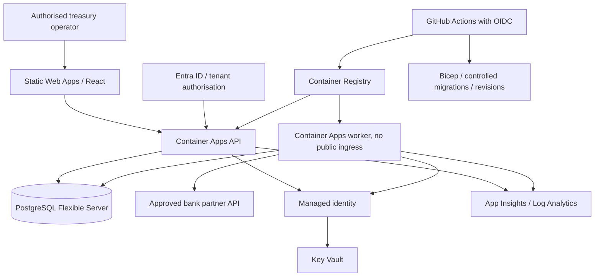

# Azure deployment and operations design

**Status: designed; nothing has been deployed to Azure.** The Bicep foundation compiles with the official Bicep CLI locally; it is a proposal and has not been validated against an Azure subscription. The current runtime implements only SQLite and mock banks. Setting Database__Provider=PostgreSql deliberately fails until that adapter is implemented/tested. Do not deploy this demonstrator as a real-money system.

## Target topology



One environment per dev/test/prod; region selected by residency/latency policy, UK South is the planning assumption. API is stateless, worker is separately scaled. UI is a static build. Production database must provide verified transactional claims and optimistic concurrency. Service Bus, APIM, Front Door/WAF and AKS are optional future additions; not prerequisites for the assessed local workflow.

## Resource/configuration plan

| Resource | Initial design | Production considerations |
|---|---|---|
| Container Apps environment | Log Analytics integration, consumption | Private networking/egress, regional capacity, approved workload profiles |
| API container | 0.5 vCPU / 1 GiB, 1 minimum replica, HTTP scaling | Capacity/HA based on measured load; health probes and revision traffic shift |
| Worker container | 0.5 vCPU / 1 GiB, 1 replica, no external ingress | Multiple workers only after PostgreSQL claim/lease/load tests; bank quotas and progress alerts |
| Static Web Apps | Static React dist, SPA fallback | Entra integration, protected API route/CORS, environment-specific API configuration |
| PostgreSQL Flexible Server | Dev burstable tier; 32 GiB initial storage | HA, private endpoint/network design, pooling, PITR/restore and maintenance capacity |
| ACR | Basic dev, immutable commit image tags | Scanning, retention, SBOM/signing, AcrPull role to workload identity |
| Key Vault | RBAC, soft delete/purge protection | Secret rotation, access reviews, network controls, bank credential ownership |
| Managed identity | Runtime identity for secret/registry access | Least privilege and separate release/runtime identities |
| App Insights/Log Analytics | Traces, metrics, structured logs, retention | Sampling/daily budgets; critical business audit remains in DB |
| Monitor alerts | Unknown age, no progress, DB/provider/audit errors | Approved SLA thresholds and treasury/platform on-call routing |

Container Apps Key Vault references require an enabled managed identity and appropriate secret access. See [official secret configuration](https://learn.microsoft.com/en-us/azure/container-apps/manage-secrets). Managed identity is not a substitute for bank credential contracts or API end-user authentication.

Configuration to introduce after implementing the PostgreSQL adapter:

```text
ASPNETCORE_ENVIRONMENT=Production
Database__Provider=PostgreSql
ConnectionStrings__Treasury=<Key Vault/identity-backed configuration>
Processing__EmbeddedWorker=false
Frontend__OpenBrowser=false
Banking__BaseUrl=<approved bank adapter endpoint>
Observability__ServiceName=RippleTreasury.Api|RippleTreasury.Worker
OTEL_EXPORTER_OTLP_ENDPOINT=<configured collector endpoint>
```

The current Banking:BaseUrl is one Development mock service that distinguishes two provider routes. Real providers need separately configured credentials, URLs, throttles, timeouts and authoritative outcome mapping. Mock routes and Swagger are Development-only. CORS and UI API configuration must be implemented for separate hosted origins; the local Vite proxy is development-only.

## Bicep and release artifacts

`deploy/azure/main.bicep` proposes a resource foundation (ACR, monitoring, identity, Key Vault, PostgreSQL, SWA and Container Apps environment). Application revisions are intentionally gated by future adapter/auth/bank work. It is not an assertion that provisioning these resources produces a working production payment service. Review versions, policy, networking, roles, secret handling and quotas in an isolated subscription before using it. Infrastructure resources incur costs even when application deployment is gated.

`deploy/docker/Dockerfile.api` and `.worker` describe container packaging. Docker commands have not been verified here. `.github/workflows/ci.yml` specifies restore/build/tests, frontend lint/build and browser reconciliation. The workflow has been authored; no remote GitHub Actions run has been observed. A release workflow design is provided in `deploy/azure/release-workflow.example.yml`; it is not enabled and requires environment identities, adapter gates and controlled migrations.

Before deploying, platform engineering must complete resource-specific managed identity role assignments (AcrPull, Key Vault Secrets User), PostgreSQL identity/password management, private networking/DNS, trusted TLS, production API ingress/auth and data retention policy. No passwords appear in committed configuration. Secure Bicep parameters must be supplied from approved secret delivery, not committed parameter files.

## Release procedure (planned, not executed)

1. Protect main branch; require CI, review, dependency/secret scans and security sign-off. Pin action versions/digests according to organisation policy.
2. GitHub Actions obtains Azure access using OIDC federated identity; do not store a long-lived subscription service-principal secret. Restrict contributor permissions to the deployment scope and use protected production environments.
3. Produce API/worker images from the reviewed commit and static UI build from the same source; tag images with immutable SHA and generate SBOM/security scan/signature evidence.
4. Run Bicep build/lint, what-if, policy/security review and deploy resource changes to staging.
5. Apply reviewed expand/contract PostgreSQL migrations in a controlled job with deployment ownership. Test backward compatibility and rollback boundaries. Do not run automatic startup migrations on every production replica.
6. Deploy API/worker revisions with readiness/liveness probes. Disable embedded worker on the API and development frontend launching; fence old dispatch owners if execution ownership changes.
7. Smoke-test idempotency, unknown-outcome reconciliation, provider routing, audit atomicity and trace flow in staging, then shift production API traffic gradually. Workers require explicit version/lease compatibility; HTTP traffic splitting alone cannot fence financial execution.
8. Deploy Static Web Apps with the approved API origin and authentication; verify CORS/tenant authorisation and E2E reconciliation.
9. Check backlog/case age, error rate, critical audit/persistence alerts and bank contracts before release acceptance.

## Rollback

Keep prior image revisions and immutable UI versions. Shift API traffic to the known-good revision only if its schema and policy remain compatible. Pause/fence worker owners, assess durable attempts and reconciliation before enabling a previous worker version. Rollback cannot reverse an external bank transfer. Database rollback is not an automatic down-migration: prefer forward repair or a reviewed expand/contract release. If restore is required, treat the restored queue as potentially stale and reconcile external execution keys before dispatch.

## Backup, continuity and monitoring

PostgreSQL automated backup retention defaults to seven days and supports retention up to 35 days; validate the chosen tier/region and current service constraints. Configure the agreed retention and run isolated restore drills. See [official backup/restore guidance](https://learn.microsoft.com/en-us/azure/postgresql/backup-restore/concepts-backup-restore). Proposed business targets such as RPO 5 minutes/RTO 1 hour are discussion inputs, not demonstrated guarantees. High availability, geo-recovery and lawful long-term audit retention need separate cost/security approvals.

Alert on oldest unresolved case, stale submissions, processing progress, provider transport failures, audit commit failure, DB readiness, telemetry disappearance and unexpected idempotency conflict growth. Route financial uncertainty to treasury operations and infrastructure faults to platform/service owners. Link alerts to [failure recovery](FAILURE_AND_RECOVERY.md). Never auto-resubmit because an alert fired. Create dashboards for per-currency counts/value, status/provider outcomes and latency; exclude identifiers from metric dimensions. Keep financial audit retention separate from sampled telemetry.

## Cost assumptions and planning envelope

Use [Azure Pricing Calculator](https://azure.microsoft.com/en-gb/pricing/calculator/) with UK South, GBP, 730 hours/month, two 0.5-vCPU/1-GiB always-on containers, low HTTP traffic, a dev burstable PostgreSQL instance/32-GiB disk, ACR Basic, low-volume Key Vault operations and 1 GiB/day of logs with 30-day retention. These are sizing assumptions, not measured traffic. Production HA, private networking, NAT/firewall, support, greater logs/storage and backup/egress can dominate the bill.

The following is an **illustrative budgeting exercise using assumed component allowances**, not a quotation or current Azure price calculation:

| Component | Assumed monthly allowance (GBP) |
|---|---:|
| API/worker compute | 50 |
| Dev PostgreSQL compute/storage/backup | 70 |
| Telemetry ingestion/retention | 65 |
| Registry/secrets/static UI/limited egress | 25 |
| Contingency (about 25%) | 55 |
| Illustrative planning envelope | 265 |

Replace every allowance with a dated calculator export and traffic/storage estimate before approval. This number is not a measured charge or production guarantee. Compare consumption idle/active billing and workload profiles using [Container Apps billing guidance](https://learn.microsoft.com/en-us/azure/container-apps/billing). Set budgets and thresholds, telemetry caps/sampling, resource tags (Owner/Environment/Project/ExpiryDate), image retention and a reviewed teardown procedure. Do not enable unnecessary HA/premium gateways for a disposable mock demo; production resiliency decisions must follow business risk.

## Completion gates remaining for an Azure deployment

PostgreSQL adapter and test parity; real bank/status evidence contracts; Entra/RBAC/tenant isolation; network/CORS configuration; all Bicep resources/roles/secret references validated; container build/run; OIDC federation and protected release environment; migrations and restore drill; production observability exporter/alerts; rollout/rollback and bank outage exercises. None is implied by a local passing build.


## Bundled deployment option

The implemented publish output now includes compiled React assets served by ASP.NET Core. Container Apps can therefore host API and UI together without Static Web Apps. Separate Static Web Apps remains the proposed Azure topology for independent UI delivery/CDN capabilities. The API Docker build stage includes Node 22; the final ASP.NET runtime stage contains only published API/assets. No container build or Azure deployment has been verified for this change. Production environment settings disable mock routes/Swagger and require the documented real-bank/identity/database work before use.


## Incremental treasury rollout considerations

The local forward migration adds FundingAccounts and nullable immutable funding/beneficiary/routing snapshots. Seeded accounts and capability availability are fictional fixture data, not production bank configuration or balances. A PostgreSQL adapter needs its own migration and preservation/concurrency tests; do not run this SQLite migration against another provider. Fence incompatible writers during schema/capability-policy rollout and retain old execution keys/provider bindings for reconciliation.

Production account onboarding must resolve trusted tenant/company ownership, validated tokenized account references, approved bank corridors and policy versions from governed reference data. Key Vault/managed identity holds credentials; neither bank credentials nor account identifiers belong in logs. Account health, bank cut-offs, liquidity/FX and verified beneficiary data require separately designed integrations. Existing uncertain payments must keep their original route even if a provider is disabled for new intake. ISO 20022 pain.001/pain.002 can be future bank adapters after profile, validation, security and status evidence contracts are tested. No deployment of these extensions is implied by local tests.
