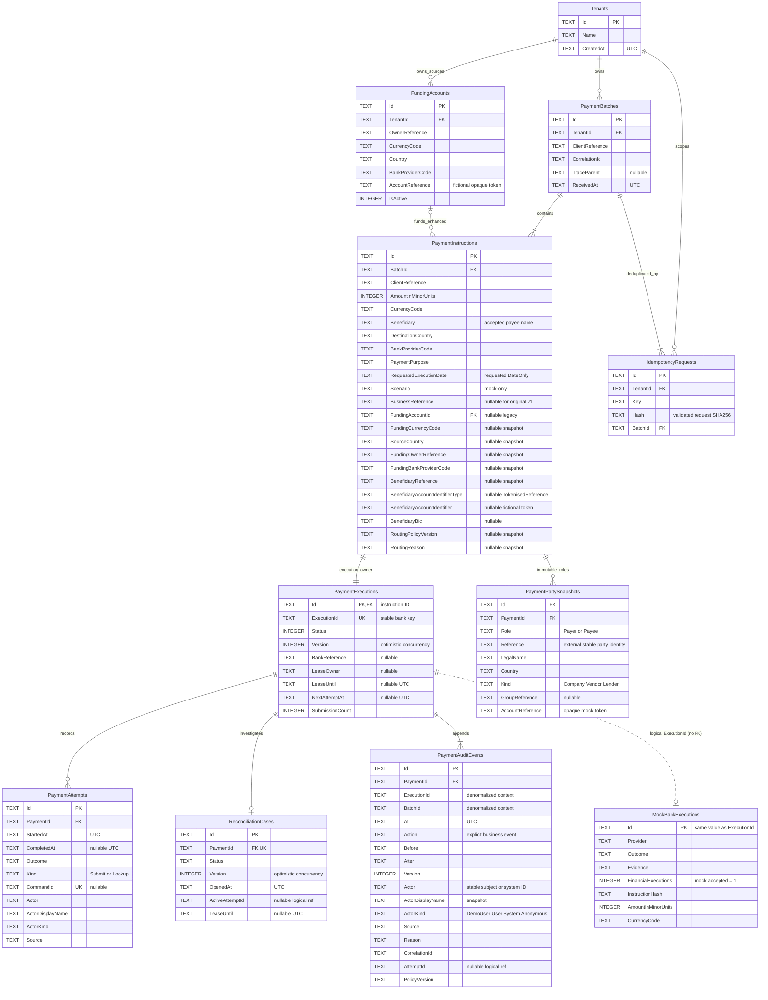

# Database design: implemented SQLite model

The diagram below reflects the EF model and checked-in migrations, including party snapshots. It shows all eleven business/mock tables. `__EFMigrationsHistory` and SQLite's migration lock are framework metadata, not financial entities. IDs are GUIDs stored as SQLite TEXT, amounts are signed Int64 INTEGER minor units, versions are INTEGER, and DateTime values are stored with UTC application semantics. DateOnly is the requested date; this is not a bank settlement promise.

## Parties and business meaning

| Purpose | Payer | Payee | Business reference | Domain validation |
|---|---|---|---|---|
| VendorDisbursement | Treasury legal company | Named vendor, e.g. Harbour Supplies GB Ltd | Invoice/payment obligation ID | Company payer, Vendor payee, different identities |
| InterCompanyTransfer | Northstar Treasury UK Ltd | Northstar Germany GmbH | Treasury transfer ID | Different Company identities in the same known corporate group |
| LoanRepayment | Treasury legal company | Named lender, e.g. Summit Commercial Finance | Loan agreement/payment reference | Company payer, Lender payee, different identities |

Each enriched instruction has exactly two role snapshots created by the intake transaction. Legal names identify counterparties; opaque account references represent future verified bank-account/vault records. No real IBAN, routing number, account credential or transfer is implemented. Currency and bank partner remain independent instruction fields. Payee name/country must agree with Beneficiary/DestinationCountry; Domain rejects conflicting representations. This demo's same-group interpretation of intercompany is an explicit assumption, not a universal finance rule.

Snapshots preserve accepted intent even if a vendor later changes its name or account. Party Reference identifies the external master record; there is intentionally no implemented mutable Companies/Vendors/Loans master module. Production adds versioned tenant-owned party/account directories, account verification, permitted currencies/rails and approval controls. Their current display names must never rewrite accepted instructions. The business reference is an identifier, not a complete invoice or loan amortisation ledger.

Original v1 callers may omit `parties`; these remain labelled original demo instructions in the UI. Existing instructions and hashes are not backfilled with invented companies. New demo scripts and representative integration fixtures include snapshots. A production contract/admission gate must require verified party/account details; optional legacy compatibility is not production readiness.

## Keys, constraints and access paths

| Table | Additional constraints/indexes | Main access |
|---|---|---|
| PaymentBatches | Unique (TenantId, ClientReference) | Receipt, overview, batch list |
| PaymentInstructions | FK BatchId RESTRICT; unique (BatchId, ClientReference) | Batch membership, due-date eligibility |
| PaymentPartySnapshots | FK PaymentId RESTRICT; unique (PaymentId, Role); role CHECK | Accepted payer/payee reconstruction |
| PaymentExecutions | Shared PK/FK instruction ID; unique ExecutionId; (Status, NextAttemptAt, LeaseUntil); concurrency Version | Durable eligible claim, recovery |
| PaymentAttempts | FK PaymentId RESTRICT; unique nullable CommandId; (PaymentId, StartedAt) | Command deduplication and timeline |
| ReconciliationCases | FK PaymentId RESTRICT; unique PaymentId; concurrency Version | Queue and guarded lookup |
| PaymentAuditEvents | FK PaymentId RESTRICT; (PaymentId, At); append-only guards | Business history |
| IdempotencyRequests | FK BatchId RESTRICT; unique (TenantId, Key) | Replay/conflict decision |
| MockBankExecutions | Unique primary execution ID | Mock execution deduplication/status lookup |

BatchId/ExecutionId/AttemptId in audit, ActiveAttemptId in cases and the mock bank's execution link are logical contextual references; only the FK fields marked in the diagram are database-enforced. Application transactions keep these contexts consistent. Stronger composite tenant/FK guarantees and query indexes need provider-specific production work. SQLite unique nullable CommandId permits multiple ordinary submission attempts without a command ID.

## Atomicity, immutability and identity

Intake commits Batch, PaymentInstructions, PaymentPartySnapshots, PaymentExecutions, IdempotencyRequests and initial PaymentAuditEvents together. A failed commit leaves none of them. Claims commit execution state, lease, attempt and audit before HTTP submission. Observation/reconciliation commits state, attempts, case and audit together. A separate mock bank transaction simulates the external bank boundary even though both registries use the same local SQLite file; this cannot establish a real bank's guarantees.

PaymentInstructions, party snapshots and audit reject updates/deletes through EF guards and SQLite triggers. Names and business references affect the new request/provider fingerprint, so reusing a key with changed party intent conflicts. Original requests without snapshots retain their canonical hash shape. Migration adds nullable party metadata and blank historical actor fields; no past user is fabricated.

PaymentAuditEvents stores actor ID, display-name snapshot, kind, source, timestamp, reason, before/after state, entity version, policy version and supporting IDs. Recheck attempts persist their initiator before bank lookup. The completion event uses that persisted actor even if request context later changes. System workers/recovery keep system identities; random demo user selection occurs only once per submitted batch, from a known synthetic directory.

Production identity belongs to Entra/OIDC, not this database. Add validated subject/tenant claims, RBAC, authorisation and maker/checker. Preserve subject/name snapshots for history instead of joining every old event to a mutable current user name. Demo headers are accepted only in Development and never establish authorisation.

## Migration and portability

One checked-in InitialTreasury migration creates all ten current tables, indexes, foreign keys, provider fingerprint fields, party snapshots, actor/action metadata and the demo tenant. Local startup applies migrations then ensures guards. Production needs controlled expand/contract migration jobs, backup/restore rehearsals and a fenced writer handover. PostgreSQL, SQL Server and Oracle adapters require their own claim SQL, migrations, unique-null semantics, time/date mappings and concurrency/fault suites. No connection-string-only swap is promised.

See [system design](SYSTEM_DESIGN.md), [failure/recovery](FAILURE_AND_RECOVERY.md) and [ADRs](adr/README.md).

## Created, updated and reconciliation dates

`PaymentDetail.History` projects CreatedAt/CreatedBy from accepted intake, LastUpdatedAt/LastUpdatedBy from the latest business audit event, and latest reconciliation attempt start/completion with its persisted initiator. These dates do not allow instruction editing or imply settlement. Raw audit retains each action/time and before/after state, including creation, submission start/observation, reconciliation start/completion and lease recovery. New audit action labels are mandatory at each writer call; old events with no label remain historical.

### Exact payment amount storage

PaymentInstructions stores AmountInMinorUnits as SQLite INTEGER (C# long), with CurrencyCode. GBP 125.50 is stored as 12550; JPY 100 is stored as 100. The domain validates the supported currency precision and converts decimal API input without rounding excess precision. The UI displays the normal currency amount. This is a common payment API convention, documented by [Stripe](https://docs.stripe.com/currencies) and [Adyen](https://docs.adyen.com/development-resources/currency-codes), rather than a universal bank wire format. Provider adapters must translate according to each provider contract. MockBankExecutions uses the same explicit amount and currency column names for its local registry.

## Tenant directory and schema names

Tenants identifies a customer organisation, seeded as demo-tenant / Northstar Treasury Group. PaymentBatches.TenantId and IdempotencyRequests.TenantId have restrictive foreign keys to it. Payer/payee companies remain immutable PaymentPartySnapshots. Legacy tenant IDs are imported with explicitly labelled imported names. This does not implement authentication or tenant-filtered reads: production requires validated tenant claims and ownership enforcement across all queries and commands.

InitialTreasury is the consolidated baseline for this new project. EF maps the domain entities directly using Infrastructure configuration classes. Earlier development migration histories are not supported by this baseline: stop API/worker processes, back up the old SQLite database and create a fresh demo database. Never use this reset procedure for production financial data. Startup applies the baseline to an empty database and reinstalls immutable guards; subsequent startup preserves existing baseline data.

## CLR entity and DbSet names

TreasuryDb uses plural entity names: PaymentBatches, PaymentInstructions, PaymentExecutions, PaymentAttempts, ReconciliationCases, PaymentAuditEvents, IdempotencyRequests, PaymentPartySnapshots, Tenants and SimulatedBankExecutions. Domain entity names are unchanged. The Infrastructure-only SimulatedBankExecution replaces the former MockBankExecution CLR name; its explicit mapping keeps the MockBankExecutions table shown in the diagram. This code naming change requires no database rename or data reset. HTTP request/response models are not EF entities.

## Incremental treasury extension

FundingAccounts is the eleventh business/reference/simulation table. TreasuryPaymentDetails is an owned value snapshot in PaymentInstructions, not a second entity table or alternate persistence model. FundingAccountId is a nullable FK; all eleven new snapshot columns remain null for historical v1 rows. Enhanced source account ownership, activity, matching currency and company/country checks are enforced before intake. Source IDs and tenant/company/currency are indexed; no balance or credential columns exist. Attempts keep their instruction FK and expose its immutable treasury context through response projection.

AddTreasuryFundingAndRouting is a forward migration after the retained InitialTreasury baseline. It seeds twelve fictional reference accounts, never rewrites accepted instructions/audit or changes legacy hashes. A populated baseline migration test verifies history, replay and guard preservation. Do not down-migrate a populated financial database as a routine rollback; fence writers and use reviewed forward repair or a compatible code revision.
