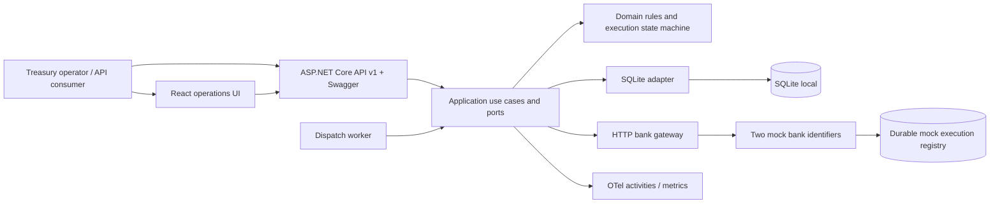
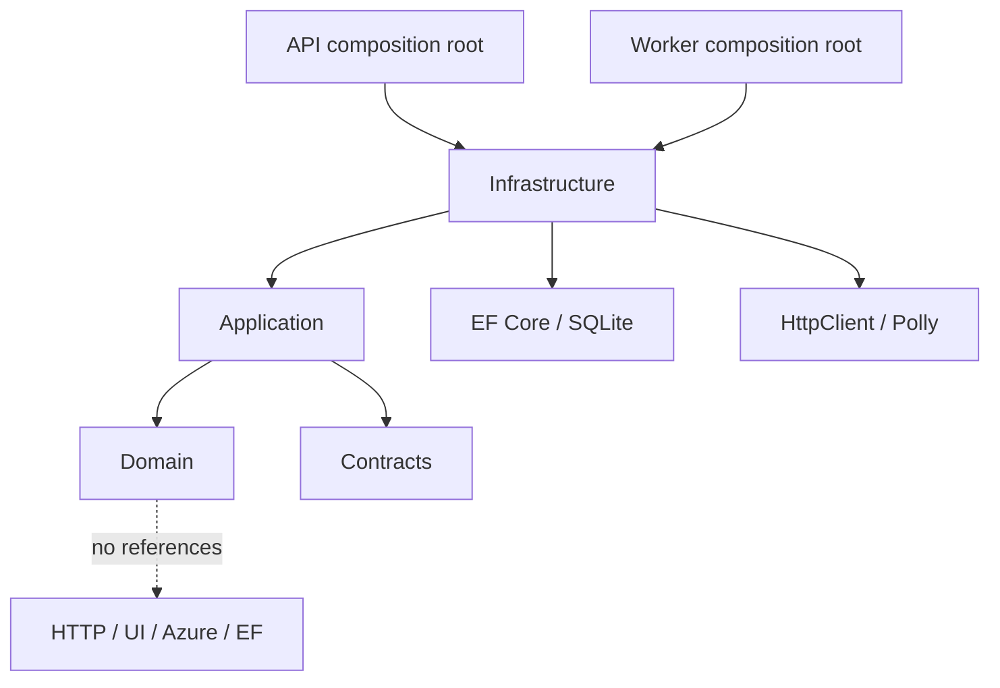
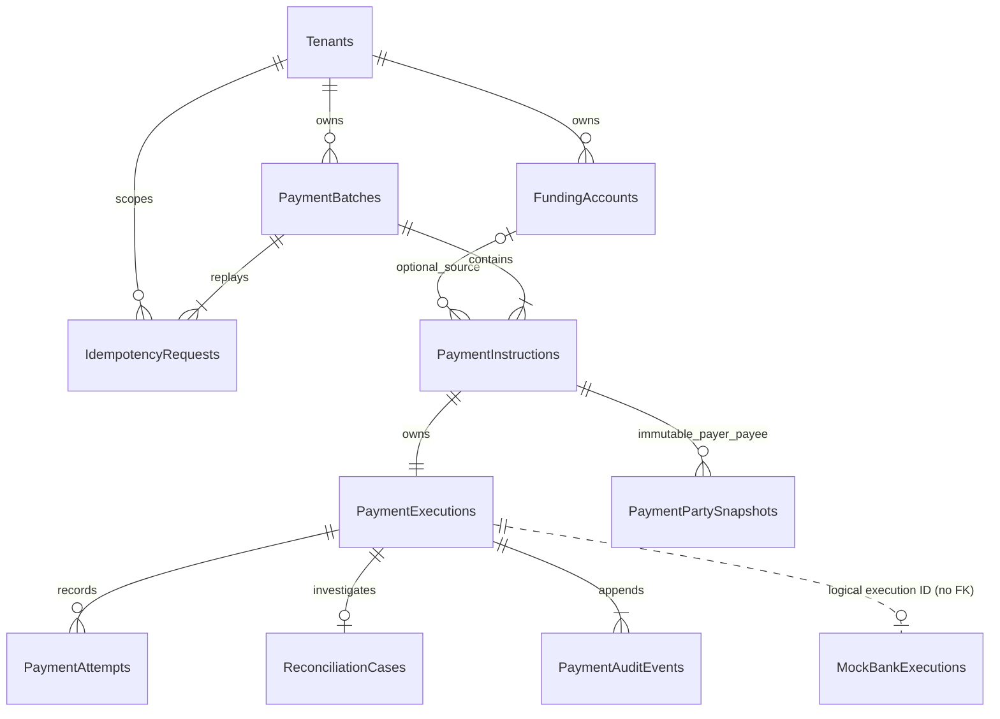
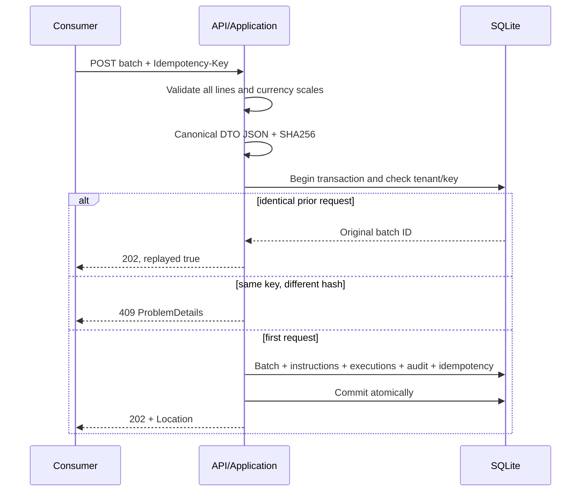
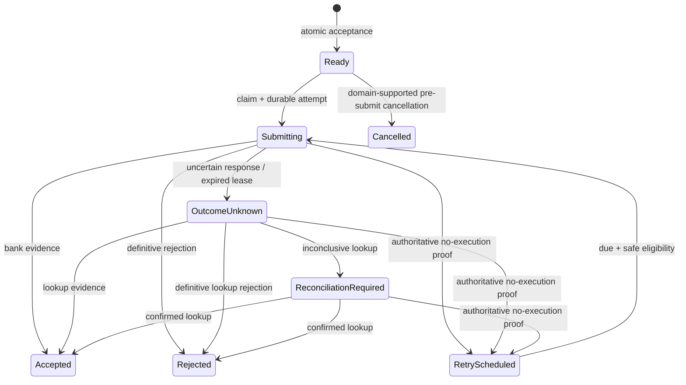
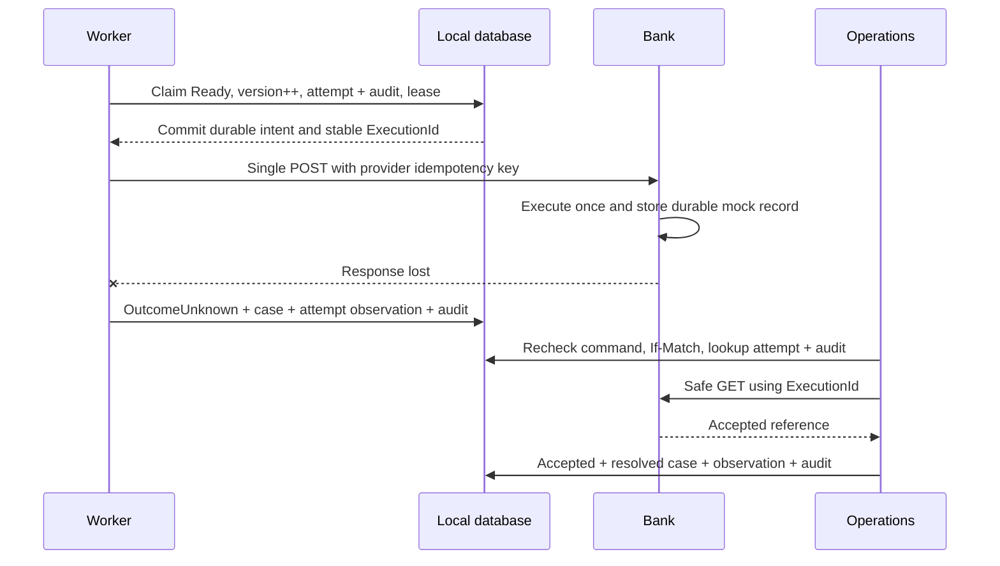

# Ripple Treasury system design

## Scope and evidence

This .NET 10 payment-orchestration service accepts batches of up to 500 corporate treasury instructions, including vendor disbursements, intercompany transfers and loan repayments. It validates money, funding accounts, beneficiaries, execution dates and supported bank capabilities; persists accepted instructions and audit history; dispatches payments in the background; and reconciles uncertain bank responses. A lightweight React UI calls the versioned API.

The verified slice uses EF Core 10 with SQLite and two deterministic mock-bank providers. Unit, provider-backed integration and Playwright tests exercise the local workflow; the [README](../README.md#run-tests) lists the commands. No live bank, clearing or settlement integration, Azure deployment, production tenant authentication, FX execution, liquidity reservation, sanctions screening or settlement guarantee is implemented. Bank acceptance is a submission outcome, not proof of settlement.

## Requirements and bounded context

The service models the treasury instruction from intake through dispatch and evidence-based reconciliation. Each instruction records its amount and currency, payment purpose, business reference, payer/payee, requested execution date and accepted route. Enhanced treasury requests also identify a company-owned funding account and a typed fictional beneficiary token. Routing checks the configured bank capabilities before acceptance; the chosen funding account and route remain fixed for retries and reconciliation. Supported currencies do not imply foreign-exchange conversion.

Payment instruction processing is the bounded context and sole owner of accepted intent, execution state, attempts, idempotency and business audit. A batch is accepted atomically, then its payments progress independently. The bank adapter supplies external observations; reconciliation records and applies that evidence through the same execution owner. Reporting reads persisted results, while the UI presents them and does not decide financial state.

The local demo uses one fixed, unauthenticated tenant and fictional companies, users and account tokens. Country/currency eligibility and execution dates follow configured demo rules; execution dates are UTC-calendar eligibility dates, not cut-off or settlement promises. Production tenant authorization, verified bank and beneficiary data, foreign exchange, liquidity controls and approval workflows require separate implementation and validation.

## Design decisions and ownership

This document covers the exercise through the system overview, architecture and data model, failure and concurrency behavior, observability, and proposed production/Azure deployment. The detailed request and worker lifecycle is in [ADR 004](adr/004-durable-processing.md); schema details are in [DATABASE_DESIGN.md](DATABASE_DESIGN.md), and operational recovery is in [FAILURE_AND_RECOVERY.md](FAILURE_AND_RECOVERY.md).

The code follows inward dependencies: Domain owns financial rules, Application coordinates use cases, Infrastructure implements persistence and bank adapters, and API/Worker host them. Keep payment transitions and audit writes within the execution owner; evolve persistence through forward migrations and preserve existing request/response contracts. Relevant tests and run commands are in [README.md](../README.md).

## Context and components

Domain is pure C#: financial intent validation, money, state/version checks, evidence-based retry decisions and batch/reconciliation policies. Application validates request shapes, canonicalises the validated contract, orchestrates ports, creates activities, and classifies ambiguous transport failure. Infrastructure maps domain entities directly, executes transactions and implements claims/leases and provider calls. API maps contracts and HTTP errors; the worker is a host. Contracts contain feature-grouped HTTP request/response models, not database entities. The future integration envelope is documented in ADR 008; no unused runtime envelope class exists.

The API hosts the worker locally and serves the compiled React production bundle from wwwroot for a single startup. The separate worker executable uses the same application services and can be run independently when the embedded worker is disabled. A separately hosted production worker and static UI remain possible without changing Domain. There are no frontend subprocesses at runtime; an independent static UI deployment remains an Azure option.

## Decisions and alternatives

See [ADRs](adr/README.md), especially [ADR 004: complete HTTP request, BatchService and background worker lifecycle](adr/004-durable-processing.md). A modular monolith keeps transactions and a single payment owner understandable. Immediate microservices would introduce eventual consistency, ownership disputes and operational burden before scale justifies them. Separate hosts provide a migration boundary.

SQLite is reproducible, local and supports real transaction/concurrency tests. Writes serialize; the demo is not a production multi-replica database. EF is isolated behind independent IBatchIntakeStore, IExecutionStore, IReconciliationStore and IPaymentReadRepository ports. Connection strings alone do not make providers portable. PostgreSQL requires its own migrations, claims, indexes and fault tests. SQL Server and Oracle require independent adapters as described below.

A domain-rich model prevents accidental generic status editing. Controllers and UI expose no arbitrary PATCH or force-pay command. Immutable instructions and execution state are separate so batch-sized locking is not required during each execution. Records/projections are kept small rather than introducing an external mediator, global UI store or distributed workflow framework.

## Data model and invariants

The [complete database design](DATABASE_DESIGN.md) includes every table/column, key, index and the distinction between enforced foreign keys and logical references. The relationship overview is:

Money uses checked decimal conversion to positive integral Int64 minor units. No floating-point arithmetic is used. Reporting aggregates each currency using BigInteger and serialises minor units as strings, avoiding both Int64 total overflow and JavaScript numeric precision loss. Status counts are separate from intended monetary totals. Totals include all instruction states and must not be interpreted as settled value.

SQLite foreign keys and unique indexes protect membership, references, execution identities, one case per payment and command IDs. Execution and case versions are EF concurrency tokens. Database triggers prevent update/delete of accepted instructions and business audit; an EF change tracker guard provides earlier feedback. These controls protect normal application writes, not a privileged database administrator. Cryptographic tamper evidence and regulated retention are production work.

EF migrations are checked in. Local startup applies the schema and invariant triggers. Production migrations must run as a controlled release job, not from every app replica. Schema changes use expand/contract and migration compatibility tests before rolling deployment.

## Intake and idempotency

Validation rejects the whole request with indexed line errors. The hash derives from validated domain instruction values with stable property order and integral minor units. JSON property ordering/whitespace and equivalent decimal scales do not change it; line order and business field values do. Unsupported enum strings are rejected. Uniqueness is enforced by the database. SQLite's immediate writer transaction serializes intake and claim races; tests issue eight simultaneous same-key requests and verify one batch. A response lost after intake commit can be recovered by replaying the same key. A pre-commit injected fault leaves no partial batch/audit/idempotency record.

Keys are retained without expiry in this demo. Production requires documented retention and key-reuse rules, authenticated tenant scope, quotas and privacy review. Client references intentionally cannot be re-used to create a second accepted batch.

## State machine and bank boundary

Accepted and Rejected cannot be claimed again. Settled is reserved and is not produced without settlement evidence. Cancellation exists as a guarded domain operation; there is no cancellation endpoint in the current UI/API.

No local DB transaction spans a network call. Payment effects and local state cannot commit atomically across systems. A claim creates an attempt before any network send. The stable ExecutionId is the mock provider key across attempts. The worker commits the result separately. If that save fails or the process crashes, the durable Submitting row is recovered after its 30-second lease. Recovery marks Unknown and opens a case; it does not redispatch.

Submission HTTP automatic retries are disabled for unsafe methods. A timeout, disconnect, malformed/empty response or non-success HTTP is treated conservatively as uncertain. GET status lookup has two retries with jitter, bounded delays, 3-second attempt timeout, 10-second total timeout and a circuit breaker through Microsoft.Extensions.Http.Resilience. The application may schedule a new durable submission only on explicit no-execution evidence. The demo safe-transient scenario guarantees failure before any execution; maximum three attempts, exponential eligibility delay. A provider NotFound is inconclusive by default.

The two mock identifiers route independently to a durable execution registry. Enhanced treasury intake enforces different bank capability matrices and source-account eligibility before committing the route. Submission carries amount in minor units, currency, beneficiary, country, purpose and execution date; a bank-side SHA256 fingerprint requires a reused execution key to match the immutable financial intent. Attempt number and fault scenario are operational metadata excluded from the fingerprint. The local registry shares the demo SQLite file but commits its bank record in a separate transaction from application state; it is a simulation of external authority, not independent production storage. They represent separate provider targets, not real bank contracts or separate deployed banks. Scenarios: accept, reject, accepted-but-lost-response, unknown and guaranteed pre-dispatch transient failure. Accepted-but-lost-response responds HTTP 504 after storing a single execution. The .NET fault tests independently assert the execution count; a browser assertion alone is not sufficient proof.

## Concurrency and recovery

A short SQLite transaction claims only due payments and commits the lease, attempt and audit together. Version and lease-owner checks fence late workers. Reconciliation records a versioned lookup command before checking the original bank execution; stale or duplicate commands cannot trigger another payment. Expired lookups can safely repeat, while uncertain outcomes remain unresolved until evidence is available. A failure on one payment does not stop others in the batch.

SQLite serializes local writes; the concurrency tests do not establish multi-region or bank-level exactly-once execution. Reporting materializes the bounded demo dataset, and pagination is not a snapshot across requests. No production throughput target is claimed.
## API, versions and UI

Base `/api/v1`. POST intake returns 202, Location and original ID on replay. Queries return paginated batch/payment/case projections, payment attempt and audit history, and per-currency summaries. Recheck requires a command GUID and numeric If-Match case version. Details return ETag. Central IExceptionHandler maps invalid request 400, domain constraint 422, stale/idempotency conflict 409, missing resource 404 and unexpected failure 500 with safe ProblemDetails, traceId and correlationId. Swagger is Development-only.

There are four independent versions: API v1; execution/case concurrency integer; integration schema v1; processing policy mock-v1. ADR 008 defines the proposed integration envelope; no runtime event contract, outbox publisher, bus or event consumer is implemented.

React/TypeScript/Vite/MUI has Dashboard & Reports, Process batch (seeded preview and submission), Batches (detail drawer) and Reconciliation (evidence panel and confirmed recheck). TanStack Query owns server cache, React useState owns local controls. Loading, empty, API error with support correlation, stale mutation error, pending command and resolved states are represented. Mutations have no automatic retries. Counts and money come from API projections. No Redux or Zustand.

## Observability and audit

Sanitized correlation IDs and persisted W3C trace context connect API, worker, reconciliation and bank calls. Structured logs and activities include operational IDs but exclude beneficiary/account payloads; errors returned to clients omit stack details. Counters and bank-latency metrics are implemented; OTLP export is optional via `OTEL_EXPORTER_OTLP_ENDPOINT`. No collector, dashboard or deployed alerting is included.

Append-only business audit is separate from telemetry and commits atomically with each state change. Events record actor, time, IDs, version, transition and reason/evidence. Demo actors are not authenticated identities, and external execution evidence comes from the bank. Readiness checks SQLite; liveness checks the process only. See [FAILURE_AND_RECOVERY.md](FAILURE_AND_RECOVERY.md) for operational response.

## Database adapter migration plan

| Provider | Implemented | Adapter design to validate | Admission tests before production use |
|---|---|---|---|
| SQLite | Yes: EF migrations and provider-backed integration tests | WAL; signed 64-bit integer minor units; immutable-row triggers; short serialized write transactions | Atomic rollback, duplicate intake, concurrent claims, stale-version fencing and restart recovery |
| PostgreSQL | Designed only | Provider-specific EF migrations; `bigint`; `timestamptz` for instants; short claim transactions using `FOR UPDATE SKIP LOCKED` or an equivalent atomic claim; preserve lease/version fencing and map unique violations | Run the persistence contract suite on PostgreSQL; test concurrent claims, migration/restore, uncertain commit recovery, isolation and expected load. `UPDATE ... RETURNING` and a separate migrations assembly are implementation choices, not requirements. |
| SQL Server | Designed only | Provider-specific EF migrations; `bigint`; `datetime2` with an enforced UTC convention or `datetimeoffset`; claim locking such as `UPDLOCK`/`READPAST` only after choosing and testing isolation and `READ_COMMITTED_SNAPSHOT` settings; use `rowversion` or integer compare-and-swap for fencing | Test deadlocks/retries, lock contention and queue fairness, transaction replay safety, restore/migration, and concurrency-token behavior under the target database settings. |
| Oracle | Designed only | Supported ODP.NET/EF provider versions and provider-specific migrations; `NUMBER(19,0)` constrained to the .NET `long` range; explicit UTC instant mapping; choose identity/sequence strategy for the supported Oracle version; short `FOR UPDATE SKIP LOCKED` claim transaction if validated for the workload | Test queue lock behavior, cancellation, constraint mapping, paging, schema upgrades, numeric boundaries and recovery under injected failures. |

The provider configuration deliberately refuses anything except Sqlite. Future adapters need not change Domain/Application, but must implement and prove persistence semantics. Replace schema bootstrap with explicit controlled migrations on production hosts. No connection-string-only parity promise.

## Event-driven and microservice evolution

1. Harden the production monolith and PostgreSQL adapter first.
2. Add an Outbox row in the same transition transaction, versioned envelope with tenant/event/aggregate/version/correlation/causation/occurredAt fields, durable publisher claims and retries.
3. Publish at least once to Service Bus; consumers use inbox unique event IDs, aggregate version awareness, delayed retry and a DLQ investigation process. Do not claim global ordering or exactly-once money.
4. Extract reporting projections first; then intake if needed. Payment Execution remains the sole writer of financial lifecycle. Reconciliation sends evidence commands to that owner; it does not independently mutate a second payment database.
5. Add bank quotas/backpressure and load-tested multi-instance workers before scaling replicas.

Outbox addresses database/event publication atomicity, never database/bank atomicity. Audit and processing ownership remain required even with a broker.

## Azure deployment

See the [Azure deployment design](AZURE_DEPLOYMENT.md) for the proposed topology and deployment approach. No Azure environment has been deployed.

## Testing approach

Tests follow the system boundaries: Domain unit tests cover financial rules; Application tests cover use-case orchestration; Infrastructure and API tests cover adapters and HTTP behavior; SQLite integration tests cover persistence, concurrency and recovery; Playwright tests cover batch processing and reconciliation through the running application. The [README](../README.md#run-tests) has the commands. These checks do not establish real-bank behavior, production database readiness, Azure deployment or measured capacity.
## Feature organisation and richer payment intent

The code is grouped by feature inside Clean Architecture layers. API `Controllers/Batches`, `Payments`, `Reconciliation`, `Reporting` and `Development` expose thin HTTP actions; Program.cs composes the host and pipeline. Application features orchestrate narrow ports. Infrastructure registers intake, execution and query adapters independently, while shared EF mappings live in Persistence/Configurations. Reconciliation shares the single execution writer rather than becoming a competing financial owner. Domain retains purpose, party/group, money and transition rules.

See [complete database design](DATABASE_DESIGN.md) for every table/column, enforced versus logical relationships, company/vendor/lender snapshots and audit actors. See [ADR 004](adr/004-durable-processing.md) for the request lifecycle, background processing, recovery and reconciliation flow, and the root README for demo steps. Ordinary classes are open; sealed immutable value records and the execution aggregate preserve invariants. Adapter replacement uses interfaces and DI, not inheritance from the SQLite implementation.

Demo users are synthetic profiles selected per batch or in the UI, not authenticated people. Actor identity/name/kind/source are saved with audit; reconciliation completion retains the persisted initiator. Production must validate trusted claims, enforce tenant authorisation and verified account references. Original instructions with no party snapshots remain unchanged and explicitly labelled legacy demo data.

DispatchService and ReconciliationService are separate application use cases. Their ports expose only the operations each workflow needs. Shared infrastructure execution ownership prevents two independent financial writers; dependency injection can replace intake, execution/reconciliation or feature queries without changing Domain or controllers.

## Bundled UI delivery

The API build/publish creates a minified, hashed Vite bundle and includes it under wwwroot. Locked npm installation and input-fingerprint checks happen during build, never during API runtime. Normal startup uses one origin/port and SPA fallback; reserved API/health/Swagger/asset paths retain 404 behavior. A separate Vite server remains an optional hot-reload workflow. Node/npm are build dependencies, not published runtime dependencies. Production-style packaging does not supply live banking, authentication or production tenant isolation.

Infrastructure folders follow responsibility, not one feature per table. Persistence contains TreasuryDb, narrow Repositories, entity Configurations, Migrations and Transactions. EF maps the domain entities directly without separate Row classes. TreasuryDb exposes entity-aligned DbSets and applies external mappings plus shared UTC/immutability guards. Application feature Mappings replace a shared query mapper; common paging validation is separate. The physical schema is unchanged by these naming and code-organization refinements. Unit tests use Given/When/Then names and sections, with Moq dependency setup in service-named application test classes; real SQLite fixtures remain in integration tests. See [README test guidance](../README.md#run-tests).
