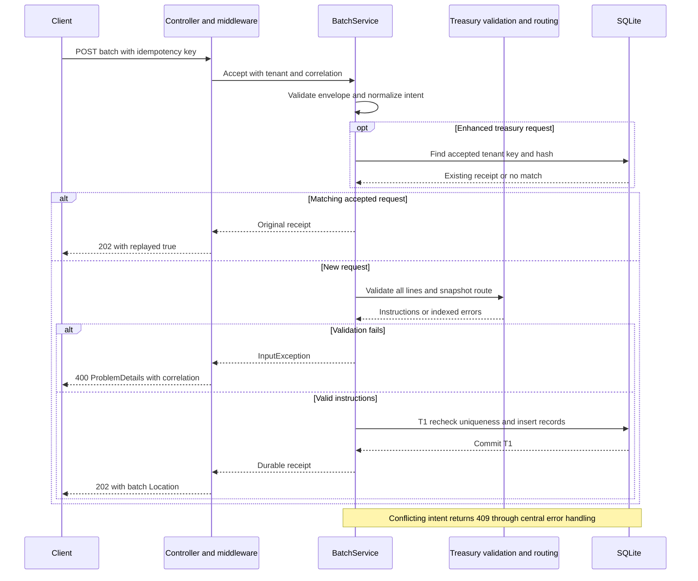
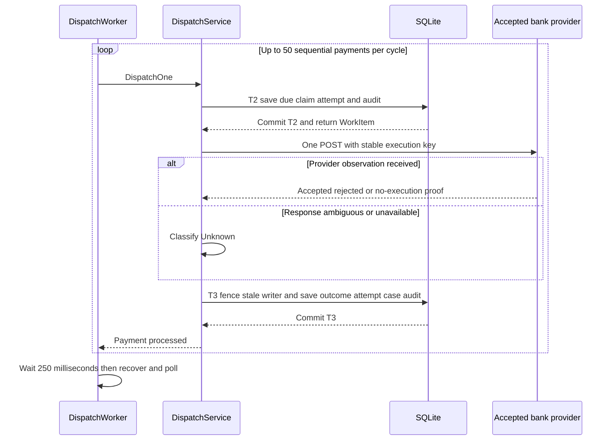
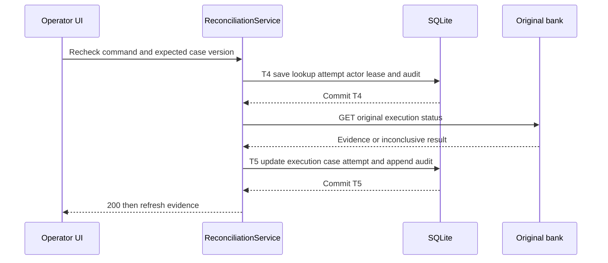

# ADR 004 — Batch request lifecycle and durable background processing

**Status:** Accepted for the implemented local workflow. Production claims, real bank contracts and hosted deployment remain future work.

## Context and decision

A treasury batch contains vendor disbursements, intercompany transfers and loan repayments. The API should acknowledge durable intake without waiting for every bank call. A bank may execute even when its response is lost or the local outcome cannot be saved.

Accept the entire valid batch atomically, then execute each payment independently through durable claims and attempts. Persist intent before contacting a bank, preserve the original provider/execution identity, and reconcile uncertainty before authorizing another submission. The database is the local durable work source; no in-memory-only queue, Hangfire scheduler or message broker is involved.

## Code navigation

| Responsibility | Implementation |
|---|---|
| HTTP acceptance | [PaymentBatchesController.Accept](../../src/RippleTreasury.Api/Controllers/Batches/PaymentBatchesController.cs) |
| Validation, replay and orchestration | [BatchService.Accept / AcceptCore](../../src/RippleTreasury.Application/Features/Batches/BatchService.cs) |
| Client-intent hash | [BatchRequestFingerprint.Create](../../src/RippleTreasury.Application/Features/Batches/BatchRequestFingerprint.cs) |
| Funding, beneficiary and routing | [TreasuryInstructionFactory.Create](../../src/RippleTreasury.Application/Features/Batches/TreasuryInstructionFactory.cs), [BankRoutingPolicy.Select](../../src/RippleTreasury.Application/Features/Routing/BankRoutingPolicy.cs) |
| Instruction and precision rules | [InstructionRules.Create](../../src/RippleTreasury.Domain/Payments/InstructionRules.cs), [Money.FromDecimal](../../src/RippleTreasury.Domain/Payments/ValueObjects/Money.cs) |
| Atomic intake | [BatchIntakeRepository.FindReplay / Accept](../../src/RippleTreasury.Infrastructure/Persistence/Repositories/BatchIntakeRepository.cs) |
| Polling and failure isolation | [DispatchWorker.ExecuteAsync](../../src/RippleTreasury.Infrastructure/Processing/DispatchWorker.cs) |
| Dispatch orchestration | [DispatchService.DispatchOne / Recover](../../src/RippleTreasury.Application/Features/Processing/DispatchService.cs) |
| Claim and result transactions | [PaymentExecutionRepository.Claim / Complete](../../src/RippleTreasury.Infrastructure/Persistence/Repositories/PaymentExecutionRepository.cs) |
| Lifecycle and retries | [PaymentExecution](../../src/RippleTreasury.Domain/Payments/PaymentExecution.cs), [PaymentPolicy.Observe](../../src/RippleTreasury.Domain/Payments/PaymentPolicy.cs) |
| Provider HTTP boundary | [HttpBankGateway.Submit / Lookup](../../src/RippleTreasury.Infrastructure/Banking/Http/HttpBankGateway.cs) |
| Interrupted-work recovery | [PaymentExecutionRepository.RecoverExpired](../../src/RippleTreasury.Infrastructure/Persistence/Repositories/PaymentExecutionRepository.Recovery.cs) |
| Operator recheck | [ReconciliationService.Recheck](../../src/RippleTreasury.Application/Features/Reconciliation/ReconciliationService.cs), [BeginRecheck / FinishRecheck](../../src/RippleTreasury.Infrastructure/Persistence/Repositories/PaymentExecutionRepository.Reconciliation.cs) |
| Audit and HTTP errors | [BusinessAuditWriter.Audit](../../src/RippleTreasury.Infrastructure/Persistence/BusinessAuditWriter.cs), [ApiExceptionHandler](../../src/RippleTreasury.Api/Middleware/ApiExceptionHandler.cs) |

## 1. Startup and ownership

1. The API build installs locked npm dependencies when required, builds React and includes the static bundle in its output. This happens at build time, not application runtime.
2. API startup registers application ports/adapters, resolves SQLite configuration, applies pending EF migrations and installs WAL/immutability guards through TreasuryDatabaseInitializer. Repeated startup preserves existing payments.
3. With Processing:EmbeddedWorker=true, the API registers DispatchWorker as a .NET BackgroundService. It waits for ApplicationStarted because the local mock banks use that API listener.
4. React, API and embedded worker use one host. The separate worker executable uses the same application services; disable the API worker when using it.
5. SQLite retains pending work after process restart. Dispatch is independent of the original HTTP request.

One recommended SQLite dispatcher is the local operating assumption. Local competing-claim tests do not establish production scale-out readiness.

## 2. HTTP request lifecycle

### Receive and delegate

The client sends POST /api/v1/payment-batches with CreatePaymentBatchRequestModel and Idempotency-Key. CorrelationMiddleware validates or creates a correlation ID; ASP.NET Core supplies trace context. The controller currently uses fixed demo-tenant scope. Demo user headers provide synthetic attribution, not authentication.

PaymentBatchesController calls IBatchService.Accept with tenant, key, correlation ID, trace parent and cancellation token. It never calls a banking partner.

### Enter BatchService

Accept creates a tenant/correlation logging scope and batch.accept activity. It logs the payment count and delegates to AcceptCore. Validation, conflict, cancellation and unexpected failure paths are logged without request bodies, account identifiers or idempotency keys. A committed receipt is logged only after persistence returns.

### Validate the envelope

AcceptCore requires:
- An idempotency key of at most 128 characters.
- A batch client reference of at most 100 characters.
- Between 1 and 500 instructions.

An invalid count rejects immediately; other line errors are collected with indexed fields. ClientReference is the caller's business label, separate from the server-generated batch GUID and idempotency key.

### Replay accepted enhanced intent before checking current availability

For requests containing treasury data, BatchRequestFingerprint normalizes caller intent. FindReplay checks committed tenant/key/hash before resolving current source accounts or capabilities.

| Prior evidence | Result |
|---|---|
| No tenant/key match | Continue new-intake validation |
| Same key and same intent | Return original batch ID, Replayed=true |
| Same key but different intent | Conflict; no new batch or route |

Thus a disabled bank can block new payments without invalidating an already accepted replay. Legacy requests preserve their established hash and transaction-level replay path.

The preflight read is not race protection. The final intake transaction repeats the authoritative uniqueness/idempotency check.

### Validate all instructions and freeze routing

BatchService creates candidate IDs in memory, enforces unique payment references within the batch, maps party snapshots and delegates business validation to Domain.

For an enhanced instruction TreasuryInstructionFactory:
1. Loads the funding account by ID and tenant.
2. Requires payer/payee snapshots, an active source account, correct company ownership and matching source/payment currency.
3. Validates the fictional typed beneficiary token and optional BIC syntax.
4. Requires provider and preferredBankId to agree when both are supplied.
5. Calls BankRoutingPolicy. Domain capability checks require source-account/bank association, country/currency, configured availability and destination/currency support. Selection uses priority then provider ID, or validates an explicit preference.
6. Builds an immutable treasury snapshot and checks consistency with money and party details.

InstructionRules.Create and Money.FromDecimal enforce positive amounts, currency scale/overflow, supported purpose/country/provider, required date, references and party consistency. No bank is contacted during intake.

If one new instruction is invalid, the entire batch is rejected before persistence. Indexed validationCodes identify enhanced treasury failures. No instruction, initial business audit or idempotency row is accepted. Operational rejection logs are separate from committed business history.

### Fingerprint and commit intake — transaction T1

The hash represents normalized caller intent, including optional parties/treasury. Generated IDs and current routing output are excluded. Equivalent decimal values preserve intent; line order and financial field changes remain significant.

BatchIntakeRepository.Accept begins T1 and checks tenant/key/hash plus tenant-wide batch-reference uniqueness. SQLite transaction/index protections remain the final concurrency authority.

First acceptance inserts:
- One PaymentBatches row: reference, ReceivedAt, correlation and trace context.
- One immutable PaymentInstructions row per payment, with treasury snapshot where supplied.
- Payer/payee PaymentPartySnapshots when supplied.
- One PaymentExecutions row per instruction, initially Ready, with stable ExecutionId.
- One IdempotencyRequests row mapping tenant/key/hash to batch.
- One InstructionCreated PaymentAuditEvents row per instruction, capturing actor/time and enhanced routing evidence.

These commit together. Pre-commit failure rolls everything back. Matching replay adds no instruction/audit rows. If commit succeeds but the HTTP response is lost, the same key and unchanged payload recover the original receipt.

### Return HTTP 202

The controller returns Id/Replayed and Location: /api/v1/payment-batches/{id}. It does not wait for bank calls. The worker may begin as soon as T1 commits, even before the client receives its response.

HTTP 202 means durable treasury intake. A later payment Accepted means provider acknowledgement. Neither means settlement.

## 3. Background worker lifecycle

### Poll the durable work source

Each cycle first runs Recover, then up to 50 sequential DispatchOne calls. It stops early if no eligible work exists and waits 250 milliseconds before repeating. A cycle-level infrastructure failure uses a one-second delay. Per-payment exceptions are logged so unrelated instructions continue.

These are delays after processing, not a fixed start frequency or throughput SLA. The worker makes sequential calls, not 50 concurrent bank submissions.

### Select and claim one payment — transaction T2

Claim joins PaymentExecutions to PaymentInstructions and selects:
- Ready payments, or RetryScheduled payments whose NextAttemptAt is due.
- Instructions whose ExecutionDate is on or before today's UTC date.
- Ordered by payment ID; this is not a business-priority/fairness scheduler.

Future instructions remain Ready with no attempt until due. Weekend, holiday, local cut-off and settlement calendars are not implemented.

In T2:
1. Domain Claim checks allowed state/version and transitions to Submitting.
2. Version and submission count advance; worker ID and a 30-second lease are saved.
3. A new PaymentAttempts row records submission identity and start time.
4. SubmissionStarted audit records the transition.
5. Commit returns a WorkItem containing accepted instruction, execution, attempt and correlation/trace context.

No bank call occurs unless the claim transaction commits. A lease is temporary processing ownership, not proof of bank outcome.

### Submit outside a database transaction

DispatchService calls IBankGateway.Submit once. HttpBankGateway sends POST to the accepted provider using ExecutionId as provider Idempotency-Key. AttemptId changes per try; ExecutionId remains stable.

Dispatch, safe retry and reconciliation read accepted intent and never re-run routing or fail over an uncertain payment. Unsafe automatic HTTP retries are disabled. Timeout, disconnect, non-success status or malformed observation is conservative uncertainty.

No local database transaction spans the network call. The simulated bank commits its own execution separately. It shares the demo SQLite file but its record is outside the treasury outcome transaction.

### Persist the observed outcome — transaction T3

Complete reloads the execution and checks expected version, Submitting state and lease owner. A stale worker cannot overwrite a newer result.

Domain RecordObservation/PaymentPolicy decides:

| Observation | Result |
|---|---|
| Accepted evidence | Accepted |
| Definitive rejection | Rejected |
| ProvenNotExecuted below the three-attempt budget | RetryScheduled with exponential eligibility delay |
| ProvenNotExecuted after budget exhaustion | Rejected with no-execution explanation |
| Unknown/ambiguous result | OutcomeUnknown |

T3 updates the same execution and submission attempt, inserts/reopens a per-payment reconciliation case if required, and appends SubmissionObserved audit. Commit succeeds before outcome logging/metrics claim the result was recorded.

Generic HTTP 429/500/timeout is not no-execution proof. The simulated safe-transient/rate-limit fixtures explicitly guarantee non-execution; that specific evidence permits another durable attempt.

## 4. Interruption, retries and reconciliation

Failure at payment 40 does not resend payments 1–39 or discard payments 41–100. The worker selects independent eligible executions, not the original batch payload.

| Interruption | Durable evidence | Recovery |
|---|---|---|
| Before T1 commit | No accepted batch | Caller may repeat the same request |
| T1 committed, response lost | Batch/idempotency exist | Return original batch on replay |
| Before T2 commit | No committed claim/attempt | Payment remains eligible |
| T2 committed, crash before/after possible send | Submitting, attempt and lease | Expire lease into uncertainty, never blind resend |
| Bank executed, T3 failed | External effect may exist; local attempt unresolved | Recover then query original provider/key |
| T3 committed | Outcome and audit saved | Terminal payment is not claimed again |
| Lookup started, process stopped | Lookup attempt and case lease | Expire to AwaitingEvidence; another safe lookup can be requested |

RecoverExpired handles stale submission/lookup leases transactionally. It completes the interrupted attempt with an unknown observation, appends recovery audit, and creates/reopens an investigation where needed. It never turns uncertain submission directly into Ready.

Automatic submission retries only select due RetryScheduled after authoritative no-execution evidence. Automatic background reconciliation polling is not implemented; operators initiate lookup from the UI/API.

### UI recheck — transactions T4 and T5

1. The UI reads case/payment evidence, including case version/ETag.
2. Operator confirms POST /api/v1/reconciliation-cases/{id}/recheck with a new commandId and If-Match case version.
3. BeginRecheck validates command uniqueness and case status/version. T4 inserts a Lookup PaymentAttempts row with initiating actor, sets the existing case to QueryingProvider with a 30-second lease and appends ReconciliationStarted audit.
4. ReconciliationService performs the original provider's GET status using stable ExecutionId, outside T4/T5. GET uses bounded safe resilience.
5. FinishRecheck validates execution version and active attempt. T5 updates the existing execution, same case and lookup attempt, then appends ReconciliationCompleted audit. The persisted initiating actor is retained.
6. API returns 200 with a completion message; UI refreshes evidence. Duplicate/stale commands return 409. HTTP 200 means lookup observation saved, not necessarily payment success.

Accepted/Rejected evidence resolves the case. A proven-safe scheduled retry also resolves that investigation while execution remains pending. Inconclusive evidence becomes NeedsManualReview. There is no force-paid/manual financial override.

## 5. Current records versus event history

| Table | Intake | Dispatch | UI reconciliation |
|---|---|---|---|
| PaymentBatches | Insert once | Read context | Read context |
| PaymentInstructions | Insert immutable intent | Read original route/amount | Read original route/amount |
| PaymentPartySnapshots | Insert when supplied | Read | Read |
| IdempotencyRequests | Insert once or replay | Not the dispatch queue | Unchanged |
| PaymentExecutions | Insert Ready | Update same row | Update same row |
| PaymentAttempts | None yet | New row per submission; complete that row | New row per lookup; complete that row |
| ReconciliationCases | None | Insert/reopen for uncertainty | Update same case/version |
| PaymentAuditEvents | Append InstructionCreated | Append start/outcome/recovery | Append start/completion |
| FundingAccounts | Read enhanced directory | Accepted snapshot retained | Accepted snapshot retained |
| MockBankExecutions | No financial execution | Separate simulated bank authority | Queried through provider HTTP |

A lost-response audit normally shows InstructionCreated → SubmissionStarted → SubmissionObserved (OutcomeUnknown) → ReconciliationStarted → ReconciliationCompleted (Accepted). Every event is a separate row. Submission and lookup have separate attempt rows; current state remains one execution row.

If outcome commit fails, that transaction's audit event rolls back too. Recovery appends the later durable interruption event. Technical errors may appear in logs; logs do not replace business audit.

## 6. Progress, identity and observability

UI uses BatchQueries, PaymentQueries, ReconciliationQueries and ReportingQueries. IPaymentReadRepository loads detached consistent snapshots and application mappers construct responses. Batch status is derived from child states, not a worker-updated batch status column.

| Identifier | Purpose |
|---|---|
| ClientReference | Caller business label: tenant-unique batch reference; batch-unique payment reference |
| BatchId / PaymentId | Treasury resources |
| ExecutionId | Stable provider execution/idempotency identity |
| AttemptId | Individual submission or lookup |
| CommandId | Individual operator recheck command |
| Version | Execution/case optimistic concurrency |
| CorrelationId / trace | Diagnostics, not financial deduplication |

Instruction totals are currency-separated and include rejected/uncertain instructions; they are not settled value. ILogger scopes, traces and basic metrics describe technical behavior. Transactional audit records committed business decisions. Hosted exporters, complete alert dashboards and tamper-evident archival remain production work.

## 7. Alternatives and trade-offs

| Choice | Benefit | Cost / revisit trigger |
|---|---|---|
| Atomic intake, independent execution | One invalid new line accepts nothing; later failures isolate payments | Explicit partial-intake support would require a versioned contract |
| Database polling instead of broker/Hangfire | Durable work source and fewer operating components | Polling overhead/sequential throughput; measure before adding quotas, parallelism or a broker |
| Separate claim/result commits | No DB locks held across banking HTTP | Unavoidable uncertainty window requires leases and reconciliation |
| Conservative timeout recovery | Avoid speculative duplicate financial effects | Cases may require operator/bank investigation |
| Immutable route | Retry/recheck remains tied to original external effect | Disabled banks cannot cause silent failover |
| Modular monolith, narrow ports | One lifecycle owner and understandable transactions | Extraction/provider replacement needs implementation and new admission tests |
| Synchronous recheck after durable intent | UI gets a saved observation without a job framework | Request waits for bounded lookup; async reconciliation needs a compatible command/status contract |

## 8. Verification and production boundary

- [BatchServiceTests](../../tests/RippleTreasury.Application.Tests/BatchServiceTests.cs): validation, hashes, snapshots, committed-only logs and replay before new routing.
- [DispatchServiceTests](../../tests/RippleTreasury.Application.Tests/DispatchServiceTests.cs): ambiguity, submission counts, commit failure, cancellation and trace propagation.
- [ReconciliationServiceTests](../../tests/RippleTreasury.Application.Tests/ReconciliationServiceTests.cs): lookup isolation, stale version and correlated logs.
- [PersistenceTests](../../tests/RippleTreasury.Integration.Tests/PersistenceTests.cs): intake/claim races, atomic audit rollback, lost response, safe retry identity and immutable triggers.
- [TreasuryProcessingTests](../../tests/RippleTreasury.Integration.Tests/Payments/TreasuryProcessingTests.cs): currencies, capabilities, date eligibility, disabled-bank replay and restart reconciliation.
- [Playwright](../../src/web/e2e/reconciliation.spec.ts): actual API/worker/bundled UI submission and operator recheck.

Production needs authenticated tenancy, governed accounts/beneficiaries, verified bank idempotency/status contracts, settlement feeds, tested PostgreSQL claims, controlled migrations, monitoring and restore drills. No local test proves exactly-once real-bank execution, settlement, deployed Azure or a throughput SLA.

Related: [system design](../SYSTEM_DESIGN.md), [database design](../DATABASE_DESIGN.md), [failure recovery](../FAILURE_AND_RECOVERY.md), [idempotency](005-idempotency.md), [Azure plan](../AZURE_DEPLOYMENT.md).
